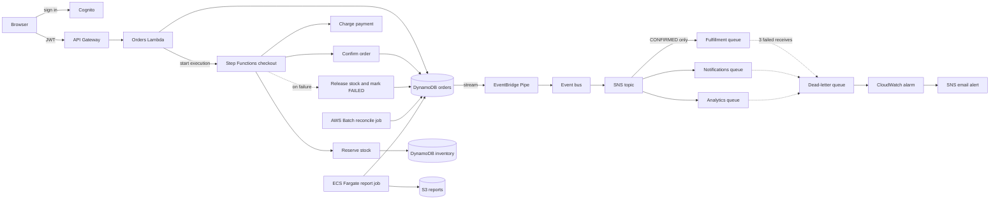
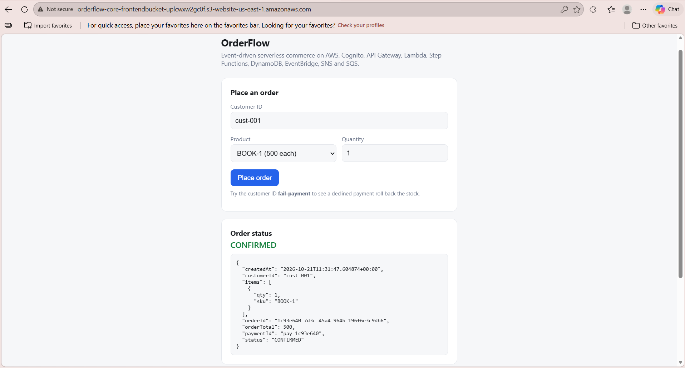
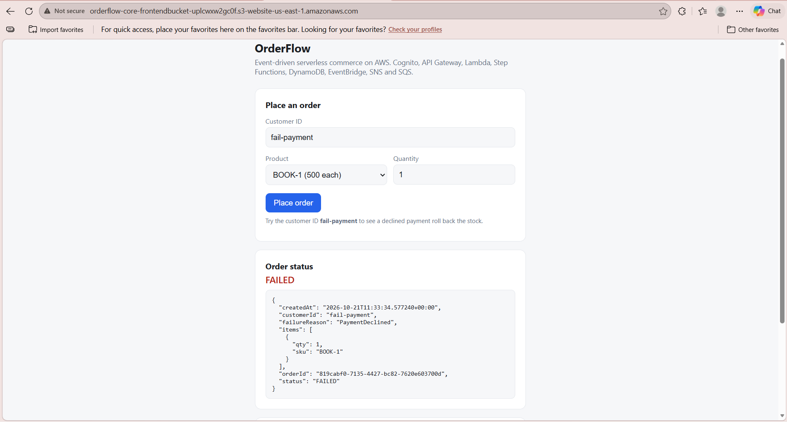
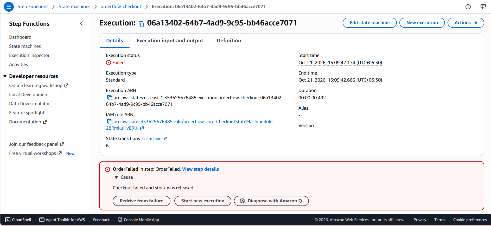
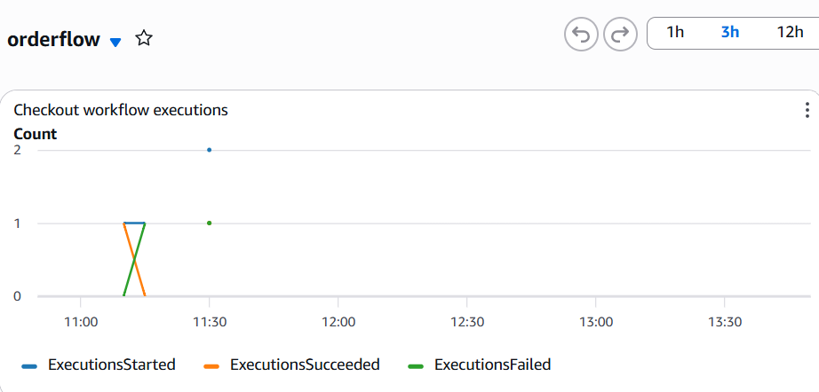
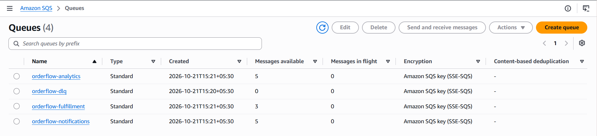
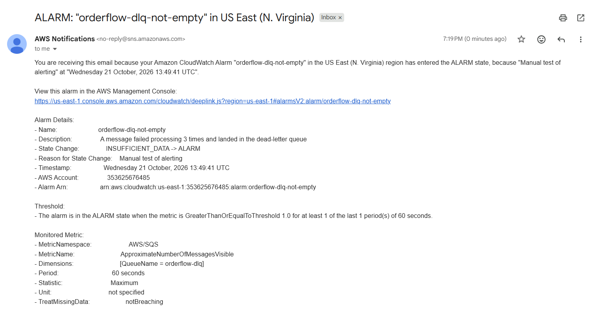

# OrderFlow: event-driven serverless commerce on AWS

A serverless order-processing backend. A customer signs in, places an order, and a Step Functions workflow reserves stock, charges payment and confirms the order, rolling everything back if a step fails. Every status change then fans out through DynamoDB Streams, EventBridge, SNS and SQS to downstream consumers. The whole stack is one SAM/CloudFormation template.

**Live demo:** http://orderflow-core-frontendbucket-uplcwxw2gc0f.s3-website-us-east-1.amazonaws.com (HTTP only for now, demo credentials available on request)

## Architecture



## How an order flows

1. The user signs in with Cognito and gets a JWT. API Gateway validates it on every route.
2. `POST /orders` stores the order as `PENDING` and starts the checkout state machine.
3. The workflow reserves stock with conditional writes (no overselling), charges payment (simulated) and confirms the order.
4. If any step fails, a compensation step returns the stock and marks the order `FAILED` (the saga pattern).
5. The status change appears on the DynamoDB Stream. An EventBridge Pipe filters for `CONFIRMED` and `FAILED` and publishes to a custom event bus, which feeds an SNS topic.
6. SNS fans out to three SQS queues. The fulfillment queue only receives `CONFIRMED` orders through a subscription filter. Messages that fail 3 times go to a dead-letter queue.
7. Two container jobs share one image: an ECS Fargate task writes a CSV order report to S3, and an AWS Batch job expires orders stuck in `PENDING` for over an hour.

## AWS services

| Area | Services |
|---|---|
| API and auth | API Gateway, Cognito user pool and authorizer |
| Compute | Lambda, Step Functions, ECS Fargate, ECR, AWS Batch |
| Data | DynamoDB (with Streams), Aurora Serverless v2 (provisioned, see limitations) |
| Messaging | EventBridge (bus and Pipes), SNS, SQS with dead-letter queue |
| Network | VPC, public and private subnets, DynamoDB gateway endpoint, security groups |
| Storage and hosting | S3 (reports and static frontend) |
| Operations | CloudWatch alarms and dashboard, SNS email alerts, IAM roles per function and task |
| Infrastructure as code | AWS SAM and CloudFormation |

## Design decisions

- **Saga with compensation.** Step Functions retries transient errors, catches business failures and always releases reserved stock.
- **No overselling.** Stock updates use a DynamoDB condition (`qtyOnHand >= :q`), so two concurrent orders cannot take the same units.
- **Fan-out with filtering.** Consumers subscribe independently, and filtering happens in SNS so the fulfillment queue never sees failed orders.
- **No NAT Gateway.** Fargate and Batch tasks run in public subnets with a public IP and a security group that allows no inbound traffic. DynamoDB traffic uses a gateway endpoint. This avoids about $32 per month.
- **Least privilege.** Each Lambda and task has its own role scoped to the tables, buckets and state machine it needs.
- **Idempotent reconciliation.** The Batch job uses a conditional update, so it never overwrites an order that changed after it was scanned.
- **Scale to zero where possible.** Aurora is configured with a minimum of 0 capacity and pauses after 5 idle minutes.

## Repository layout
template.yaml all infrastructure (SAM)
src/orders/ API Lambda (create and fetch orders, start the workflow)
src/checkout/ workflow step Lambdas (reserve, charge, confirm, fail)
statemachine/ Step Functions definition
container/ Dockerfile, report job, reconciliation job
frontend/index.html static page: sign in, place an order, watch its status
scripts/seed.json sample inventory


## Deploy

Prerequisites: AWS CLI, SAM CLI, Docker and Python 3.12.

```powershell
sam build
sam deploy --guided

# seed inventory
aws dynamodb batch-write-item --request-items file://scripts/seed.json

# build and push the job image
$repo = "<account-id>.dkr.ecr.<region>.amazonaws.com/orderflow-reports"
aws ecr get-login-password | docker login --username AWS --password-stdin "<account-id>.dkr.ecr.<region>.amazonaws.com"
docker build -t orderflow-reports container
docker tag orderflow-reports:latest "${repo}:latest"
docker push "${repo}:latest"

# upload the frontend (bucket name is in the stack outputs)
aws s3 cp frontend/index.html s3://<FrontendBucketName>/index.html --content-type "text/html; charset=utf-8"
```

Create a user with `aws cognito-idp sign-up` and `admin-confirm-sign-up`, and set your API URL and Cognito client ID in the `CFG` block at the top of `frontend/index.html`.

## Try it

- Place an order for `cust-001`: it ends as `CONFIRMED`.
- Use the customer ID `fail-payment`: payment is declined, the order ends as `FAILED` and stock is restored.
- Order more units than exist: it ends as `FAILED` with `OutOfStock`.
- Run the jobs: `aws batch submit-job --job-name reconcile --job-queue orderflow-queue --job-definition orderflow-reconcile`

## Screenshots

**A confirmed order** (stock reserved, payment charged, order confirmed)



**A failed order** (payment declined, stock released)



**Step Functions execution for a failed order** (the rollback path)



**CloudWatch dashboard**



**SQS queues created for the fan-out**


**Email alert sent by a CloudWatch alarm through SNS**


## Monitoring

CloudWatch alarms email an SNS topic when a message reaches the dead-letter queue, when 5 or more checkout workflows fail within 5 minutes, or when the orders, confirm or rollback Lambdas raise errors. The reserve and charge Lambdas are intentionally not alarmed because they raise errors on purpose for out-of-stock and declined payments. A CloudWatch dashboard shows workflow runs, queue depth and Lambda errors.

## Known limitations and roadmap

- The frontend is served over HTTP from an S3 website endpoint. CloudFront with HTTPS is planned once the account is verified for it.
- Aurora Serverless v2 is deployed with the Data API enabled, but the application does not read or write it yet. Planned use: customers and products.
- CORS is open to all origins, which is acceptable for a demo but should be restricted in production.
- Planned: AWS Backup for the orders table, Parameter Store for configuration, and a GitHub Actions deploy pipeline using OIDC.


